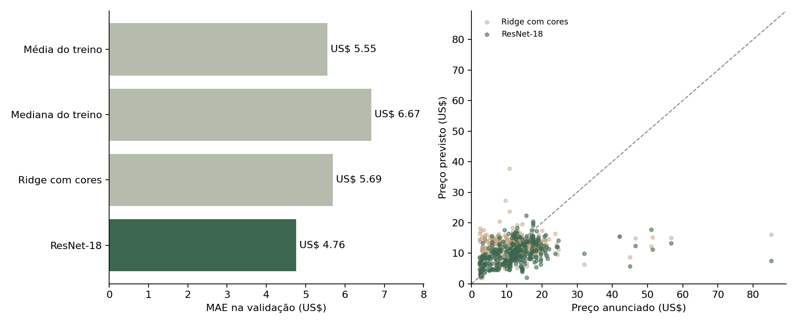
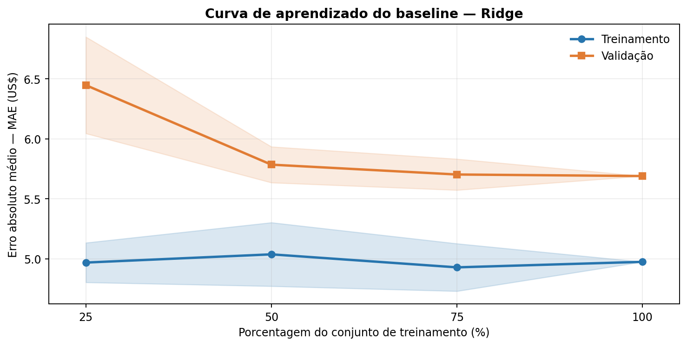

# T2 — Estimativa do preço de pratos por imagem

**João Vitor R. Almeida e Leonardo M. C. Prado**  
Redes Neurais e Aprendizado Profundo · 2026

Estimamos o preço anunciado de itens de cardápio a partir de fotografias. O alvo é o preço em dólares da base, não a disposição de uma pessoa a pagar.

## Resultados medidos

| Método | MAE de validação |
| --- | ---: |
| Média dos preços do treino | US$ 5.55 |
| Mediana dos preços do treino | US$ 6.67 |
| Ridge com cores e brilho | US$ 5.69 |
| ResNet-18 com regressão do log do preço | **US$ 4.76** |

A nova versão reduziu o MAE em **16,3%** em relação ao Ridge visual e **14,2%** em relação à média do treino. Isso não representa uma margem garantida por previsão. O R² foi apenas 0.026; a precisão ainda é limitada.

O baseline antigo concentrava previsões perto de US$ 10–13. A nova representação melhora a separação dos itens baratos, mas continua subestimando itens caros.

| Preço real em US$ | Itens | Previsão média antiga | Previsão média nova | MAE antigo | MAE novo |
| --- | ---: | ---: | ---: | ---: | ---: |
| 0–5 | 49 | 11.01 | 6.13 | 8.00 | 2.95 |
| 5–10 | 70 | 12.31 | 8.85 | 5.19 | 2.80 |
| 10–20 | 191 | 12.36 | 10.92 | 3.67 | 4.12 |
| 20–∞ | 21 | 12.88 | 11.80 | 20.31 | 21.39 |

O MAE piorou nas faixas de US$ 10–20 e acima de US$ 20. A melhoria agregada não significa melhoria em todas as faixas. Não há garantia de acertar uma lata de refrigerante ou uma pizza enviada fora da base.

## Rodar o aplicativo

Requer Python 3.12. Na raiz do projeto:

~~~bash
python -m venv .venv
~~~

Ative o ambiente no Linux ou macOS:

~~~bash
source .venv/bin/activate
~~~

No Windows PowerShell:

~~~powershell
.venv/Scripts/Activate.ps1
~~~

Instale e execute:

~~~bash
python -m pip install torch==2.14.1 torchvision==0.29.1 --index-url https://download.pytorch.org/whl/cpu
python -m pip install -r requirements.txt
python -m uvicorn src.api:app --host 127.0.0.1 --port 8000
~~~

Abra http://127.0.0.1:8000. O aplicativo aceita JPG, PNG e WEBP de até 10 MB. A foto é enviada ao processo Python e utilizada em memória; o código não a salva. A primeira execução baixa os pesos oficiais da ResNet-18, de aproximadamente 45 MB. O regressor de preços já treinado está na pasta models.

Para usar uma foto pela linha de comando:

~~~bash
python -m src.predict caminho/para/foto.jpg
~~~

O projeto inclui Dockerfile:

~~~bash
docker build -t pratos .
docker run --rm -p 8000:8000 pratos
~~~

A construção Docker não foi executada neste ambiente. O aplicativo foi verificado por requisições ASGI locais, com fotos reais e arquivos inválidos; isso não substitui revisão visual no navegador.

## Reproduzir os experimentos

As características extraídas estão em data/resnet_features.npz. Repetir as medidas não depende das URLs permanecerem disponíveis:

~~~bash
python src/train.py
python src/report.py
~~~

O notebook [Experimento.ipynb](Experimento.ipynb) também reproduz as métricas e permite testar uma foto no Colab. As cinco células de código incluídas foram executadas em CPU com IPython InteractiveShell no mesmo processo; não foi usado um kernel remoto do Colab.

Para recuperar novamente as fotos e recalcular as características:

~~~bash
python src/download_images.py
python src/extract_features.py
python src/train.py
python src/report.py
~~~

Os downloads ficam em .cache/images, ignorada pelo Git. Cada arquivo precisa corresponder ao SHA-256 original do manifesto. URLs alteradas ou indisponíveis não são substituídas silenciosamente.

## Dados e divisão

Fonte: [Restaurant Menu Items no Kaggle](https://www.kaggle.com/datasets/graphquest/restaurant-menu-items). CSV utilizado: [cópia pública](https://raw.githubusercontent.com/MahmoudHanyFathalla/AI-Powered-Restaurant-Finder/main/Scripts/restaurantmenuchanges.csv).

O M2 original utilizou 1.646 imagens de 197 restaurantes, após excluir URLs com preços conflitantes e duplicatas por hash. Nesta execução, recuperamos **1.645 imagens com o hash original**. Uma imagem do treino mudou e foi excluída; nenhuma imagem de validação ou teste foi perdida.

A divisão atual tem **1.064 imagens de treino, 331 de validação e 250 de teste reservado**. Os índices estão em data/splits.json. A separação por nome do restaurante usa semente 42, sem restaurantes em comum entre conjuntos. As proporções diferem do alvo 70/15/15 porque restaurantes inteiros ficam juntos.

As fotografias não são redistribuídas. O repositório contém URLs, preços, restaurantes, hashes e características derivadas. A disponibilidade pública das URLs não define a licença das imagens; consulte as condições da fonte antes de outros usos.

## Método

A ResNet-18 utiliza os pesos **Torchvision IMAGENET1K_V1**. Removemos a camada de classificação para obter 512 características por foto. O backbone permanece congelado: foi ajustada somente a cabeça de regressão, sem fine-tuning das camadas convolucionais.

Pré-processamento: RGB, menor lado redimensionado para 256, recorte central 224×224 e normalização ImageNet. A inferência usa a mesma transformação.

A configuração escolhida foi **StandardScaler → Ridge(alpha=1000)**, com alvo log(1 + preço) e transformação inversa expm1. O normalizador é ajustado somente no treino. Previsões negativas são limitadas a zero.

Foram comparadas 16 configurações: Ridge com alvo original ou logarítmico, Extra Trees e vizinhos próximos. A escolha usou MAE médio em **GroupKFold de três partições dos restaurantes de treino**. A validação externa foi consultada depois da escolha. O diagnóstico do baseline já havia sido visto antes desta melhoria; estas medidas continuam exploratórias. O teste final permanece sem avaliação.

| Configuração | MAE na validação cruzada do treino |
| --- | ---: |
| resnet_ridge_log_1000 | 4.8268 |
| resnet_ridge_log_10000 | 4.8652 |
| resnet_trees_leaf8 | 4.9512 |
| resnet_trees_leaf20 | 4.9600 |
| resnet_trees_leaf2 | 5.0337 |
| resnet_ridge_raw_10000 | 5.0717 |
| resnet_ridge_raw_1000 | 5.3804 |
| resnet_knn_30 | 5.3891 |
| resnet_ridge_log_100 | 5.4118 |
| resnet_knn_15 | 5.5052 |
| resnet_knn_5 | 5.5723 |
| resnet_ridge_raw_100 | 6.4732 |
| resnet_ridge_log_10 | 6.7196 |
| resnet_ridge_raw_10 | 8.0939 |
| resnet_ridge_log_1 | 8.6230 |
| resnet_ridge_raw_1 | 9.7381 |

A curva em results/learning_curve.csv repete 25%, 50% e 100% do treino, com sementes 42, 123 e 2026, mantendo os conjuntos externos fixos. As sementes variam os subconjuntos; com todo o treino Ridge é determinístico. Essa dispersão não mede a incerteza sobre outras divisões.

Tempos medidos em CPU nesta máquina: recuperação e verificação das imagens **341.9 s**, extração ResNet **52.1 s**, seleção e ajuste dos regressores **10.2 s**. Os tempos dependem do hardware e da rede.

## Entrega M2

O conteúdo do relatório que estava em Word está em [docs/M2.md](docs/M2.md), com a figura e o parágrafo originais. A análise posterior corrige a interpretação: o baseline superava a mediana, mas perdia para a média do treino.

## Organização

| Caminho | Conteúdo |
| --- | --- |
| src/download_images.py | Recuperação e verificação das fotos |
| src/extract_features.py | Características da ResNet-18 |
| src/train.py | Seleção e ajuste dos regressores |
| src/predict.py | Inferência por fotografia |
| src/api.py e web/ | Aplicativo com upload |
| models/ | Cabeças treinadas e configuração |
| data/ | Manifesto, características e índices |
| results/ | Métricas, figuras e previsões individuais |
| docs/M2.md | Texto e figura da entrega M2 |
| tests/test_pipeline.py | Separação dos dados e fluxo de upload |

## Limitações

Preço depende de porção, quantidade, restaurante, localização e contexto comercial. Uma foto isolada pode não conter essas informações. A base inclui bebidas, acompanhamentos e combos; não representa somente pratos individuais. Produtos visualmente semelhantes podem ter preços diferentes.

A melhoria é preliminar. Ainda não foi calculado erro no teste final, nem demonstrada generalização para cardápios brasileiros ou fotos arbitrárias. A rede não foi treinada para rejeitar imagens fora do domínio.

## Verificação

Os três testes passaram: separação de restaurantes e reserva do teste final; rejeição de arquivos inválidos; e upload de duas fotos reais com previsões distintas e equivalentes às medidas salvas.

~~~bash
python -m pip install -r requirements-dev.txt
python -m pytest tests -q
~~~

## Referências

- [He et al. — Deep Residual Learning for Image Recognition](https://arxiv.org/abs/1512.03385).
- [Torchvision — ResNet-18 e transformações](https://docs.pytorch.org/vision/main/models/generated/torchvision.models.resnet18.html).
